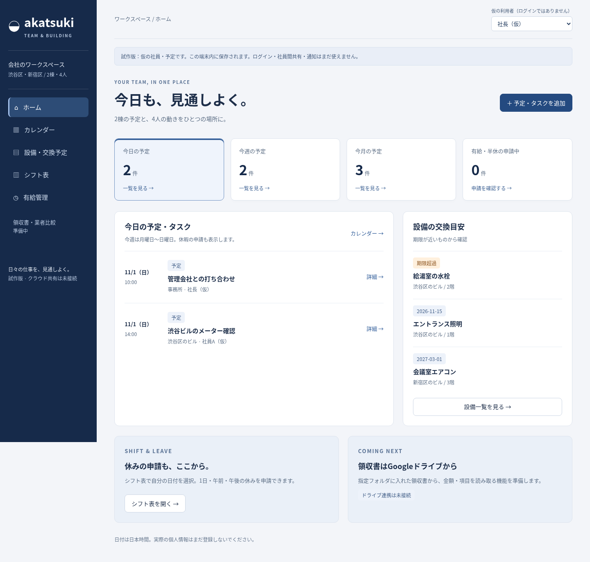

# はじめに

ネイビーと読みやすいゴシック体を使った、会社の予定・設備・休みを管理する試作品です。
今は仮の社員名とデータで操作を確認する段階です。コードの入力は不要です。

## ホーム

「今日の予定」「今週の予定」「今月の予定」を押すと、下に一覧が出ます。
設備の交換目安や、有給の申請中の件数も確認できます。
画像は画面の写真なので、画像内のボタンは押せません。

## カレンダー

「予定・タスクを追加」で、来客対応・ビル点検・メーター検査などを登録できます。
担当者・日付・時刻・場所を選び、終わった仕事は「完了」にできます。
スマホでは、カレンダーの日付を押すとその日の詳細が下に出ます。

[スマホ用のカレンダーを見る](images/calendar-mobile.png)

## シフトと有給

1. 「シフト表」で自分の行の日付を押します。
2. 出勤・公休・有給（1日）・午前休・午後休を選びます。
3. 有給・半休は「申請中」になります。
4. 管理者が「有給管理」で承認すると確定します。

午前休・午後休はそれぞれ0.5日として数えます。
申請中の日数も残りから差し引き、上限を超えて申請できないようにしています。
付与日数の初期値「10日」は仮の設定です。管理者が期間と日数を設定できます。

画面上部の「仮の利用者」は説明用の切替です。実際のログインではありません。
実際の会社のルールによる繰越・失効などは、これから対応します。

## PDFを保存する

シフト表・有給管理の「PDF保存」を押すと、PDFファイルを端末に保存できます。
今は仮の書式です。後日いただく会社のフォーマットに合わせます。
Googleドライブへの直接保存は未接続です。現在は、保存したPDFを手動でアップロードできます。

## これから準備すること

社員ごとのログイン、管理者からのメール招待、4人での共有、Googleドライブとの接続、領収書の読み取り、通知はこれからです。
現在のデータは使用したブラウザ内に保存されます。実際の個人情報はまだ登録しないでください。
ご本人の設定が必要になったら、画面に合わせて一つずつ案内します。

## 今回できたログイン機能

社員ごとのログイン、専用リンクからの登録、共有データの保存、退職者の利用停止を、開発環境で動作確認しました。
通常の画面ではログインが必要です。「仮のデータで画面を見る」は説明用の試作を開きます。
管理者が「社員・招待」でリンクを発行し、本人がパスワードを決めます。メール自動送信はまだ接続していません。
データを読み直すには「最新に更新」を押します。ほかの人と同時に変更した場合は、そのまま上書きせず確認を求めます。
会社で使う公開URLや保存先の契約はまだです。ご本人に必要な操作は、公開先を決めたあと一つずつ案内します。
